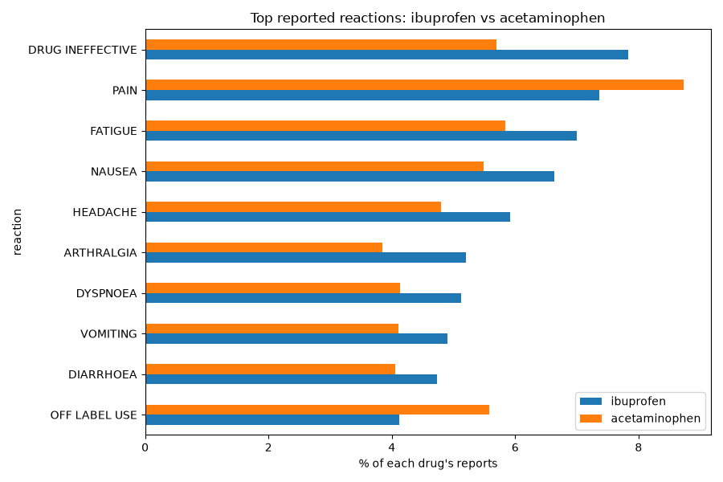
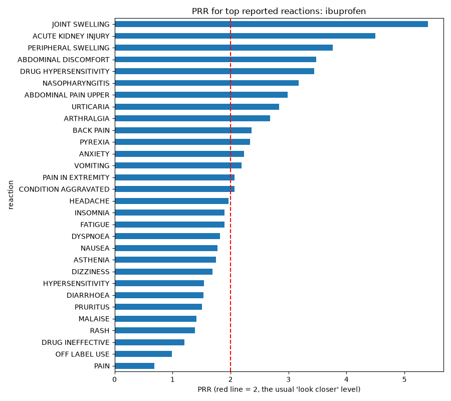

# Drug Adverse Event Explorer

Python tools that use the FDA's public adverse event reports (openFDA) to explore the most reported side effects of a drug, compare two drugs, and calculate a simple safety signal score (PRR).

## 1. Top side effects for one drug

`explore.py` gets the most reported side effects for a drug and draws a bar chart.

Example: top reported side effects for ibuprofen.

## 2. Drug comparison

`compare.py` puts two drugs side by side (ibuprofen and acetaminophen).

Each bar shows the side effect as a percentage of that drug's own reports, so a drug with more reports is not unfairly compared.

## 3. Signal check (PRR)

`prr.py` calculates the PRR (Proportional Reporting Ratio) for each side effect. PRR asks: is this side effect reported more often for this drug than for all other drugs? A PRR of 2 or more, with enough reports, is a common rule of thumb for a possible signal that deserves a closer look.

## How to run

1. Download this project
2. Install the tools: `pip install -r requirements.txt`
3. Open the script you want and change the drug name at the top
4. Run `python explore.py` for one drug
5. Run `python compare.py` to compare two drugs
6. Run `python prr.py` to calculate PRR signal scores

## Important note

These numbers show side effects that people *reported*. They do not prove the drug caused them. Reports are voluntary, drug names are typed in free text, and many flagged signals are already known effects of the drug.

## What I learned

I learned how to get real data from the FDA using Python and turn it into a chart. I also learned how to put a project on GitHub. I learned that these reports cannot prove a drug caused a side effect.