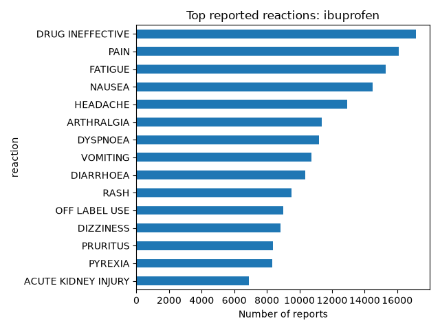

# Drug Adverse Event Explorer

This program gets side-effect reports for a drug from the FDA
and shows the 15 most reported side effects in a chart.

top reported side effects for ibuprofen.

## How to use it
1. Download this project
2. Install the tools: `pip install -r requirements.txt`
3. Open `explore.py` and change the drug name
4. Run it: `python explore.py`

## Important note
These numbers show side effects that people *reported*. They do not
prove the drug caused them.

## What I learned
I learned how to get real data from the FDA using Python and turn it into a chart. I also learned how to put a project on GitHub. I learned that these reports cannot prove a drug caused a side effect.